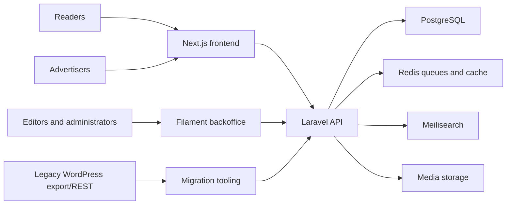

# RazbudiSe Publishing Platform

RazbudiSe is a custom publishing and advertising platform for a Macedonian editorial product. It combines a Laravel API and Filament newsroom with a public Next.js frontend.

**Status:** active development. The public repository demonstrates the application architecture and engineering work; it is not a packaged production release.

## Why it exists

The platform replaces a legacy WordPress publishing workflow with explicit editorial states, structured permissions, dependable migration tooling, reusable media, search, advertising workflows, and a responsive reader experience.

## Implemented

- Articles, authors, categories, tags, media, menus, redirects, and SEO metadata
- Draft, review, scheduled, published, and archived editorial states
- Filament newsroom with role- and permission-aware resources
- WordPress REST import, reconciliation, redirect, and media tooling
- Public Next.js article, archive, author, team, event, search, and policy pages
- Advertising products, zones, campaigns, creatives, tracking, bookings, invoices, and customer workflows
- PostgreSQL persistence, Redis queues/cache, and Meilisearch-backed search
- Backend, frontend, lint, build, and browser-oriented validation

## In development

- Final migration and launch verification
- Additional abuse controls for public write endpoints
- Operational monitoring and production-specific hardening
- Continued accessibility, responsive, and editorial workflow refinement

## Future ideas

- Mobile clients using the versioned API
- Additional editorial automation with mandatory human review
- Expanded reporting and newsroom planning tools

No automated AI author is implemented.

## Architecture



See [docs/architecture/initial-architecture.md](docs/architecture/initial-architecture.md) for the original system boundary and domain outline.

## Technology

- PHP 8.4, Laravel 13, Filament 5
- PostgreSQL, Redis, Laravel queues, Laravel Scout, Meilisearch
- Next.js 16, React, TypeScript
- Docker Compose for local services
- PHPUnit/Pest-compatible Laravel tests, Node tests, ESLint, Pint, and Playwright

## Local installation

Requirements: Docker with Compose, or PHP 8.4, Composer, Node.js 22, PostgreSQL, Redis, and Meilisearch.

```bash
cp .env.example .env
cp backend/.env.example backend/.env
cp frontend/.env.example frontend/.env
docker compose up --build
```

Local defaults:

- Frontend: `http://localhost:3001`
- Backend: `http://localhost:8001`
- API status: `http://localhost:8001/api/v1/status`
- Backoffice: `http://localhost:8001/backoffice`

The local seeder may create `admin@example.test` with the development-only password `password`. Override the `LOCAL_ADMIN_*` variables before seeding if required. These credentials must never be used outside local/testing environments.

## Validation

```bash
cd backend
composer install
cp .env.example .env
php artisan key:generate
php artisan test
./vendor/bin/pint --test

cd ../frontend
npm ci
npm test
npm run lint
npm run build
```

## Security and public boundary

Read [SECURITY.md](SECURITY.md) before reporting a vulnerability.

This repository intentionally excludes production infrastructure, server topology, deployment credentials, backup and rollback procedures, private migration evidence, unpublished editorial schedules, preview links, customer data, and operational artifacts.

Production configuration is not derived from the local Docker defaults. Public pull-request workflows receive no production secrets.

## Contributing

See [CONTRIBUTING.md](CONTRIBUTING.md). Contributions require review and must contain no credentials, personal/customer data, unpublished content, or private infrastructure details.

## License

No open-source license has been granted. The source is publicly visible for engineering review; all rights remain reserved unless a license is added explicitly.

## Disclaimer

Public source visibility does not imply that every production workflow, deployment control, dataset, or operational procedure is included. Screenshots, fixtures, and examples must use synthetic or explicitly public data.
